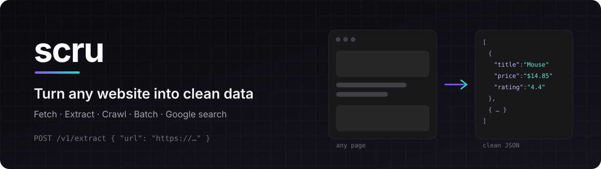
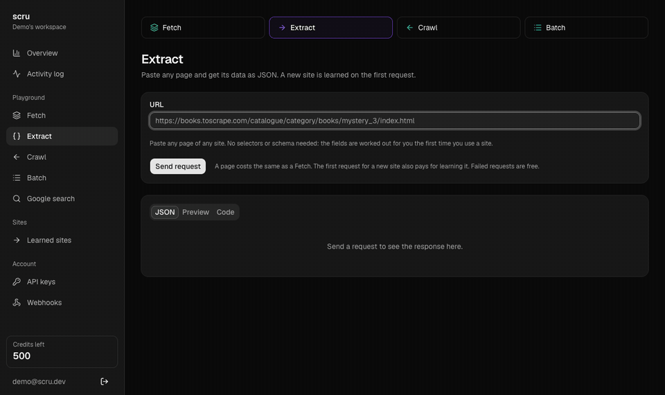
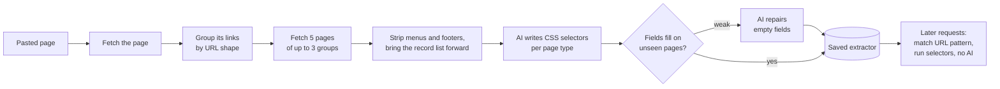
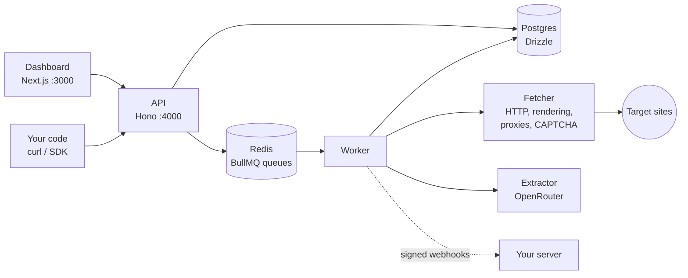
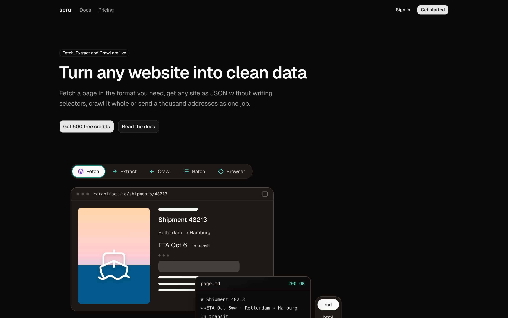
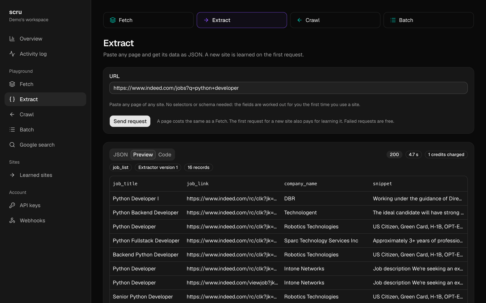
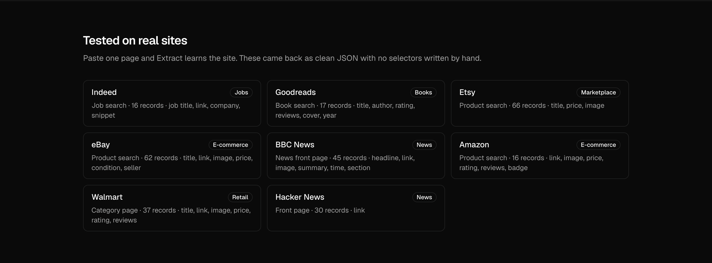

<p align="center">
  
</p>

<p align="center">
  A self-hosted scraping API. Fetch any page, get any site as JSON without writing selectors, crawl a whole site or send a thousand addresses as one job.
</p>

<p align="center">
  <a href="#quick-start">Quick start</a> ·
  <a href="#products">Products</a> ·
  <a href="#how-extract-learns-a-site">How Extract works</a> ·
  <a href="#tested-on-real-sites">Tested sites</a> ·
  <a href="#architecture">Architecture</a>
</p>

---

## Demo

Paste a page, get its records back as JSON. The first request for a new site learns it; every request after that reuses what was learned.

<p align="center">
  
</p>

## Products

| Product           | Endpoint                  | What it does                                                                               |
| ----------------- | ------------------------- | ------------------------------------------------------------------------------------------ |
| **Fetch**         | `POST /v1/fetch`          | Any page as HTML, Markdown, text, a screenshot or JSON, with rendering and premium proxies |
| **Extract**       | `POST /v1/extract`        | Any page as structured JSON; the site's fields are learned on the first request            |
| **Crawl**         | `POST /v1/crawl`          | Follows a site's links as a background task and returns every page                         |
| **Batch**         | `POST /v1/batch`          | Up to thousands of addresses in one job, with progress and per-page results                |
| **Google search** | `POST /v1/monitor/google` | Organic results, People also ask, related searches and the knowledge panel as JSON         |

Every product also runs as an async task (`/v1/async/task`) with signed webhooks. Failed requests cost nothing.

## Quick start

Requirements: Node 22.18+, pnpm and Docker.

```sh
cp .env.example .env
pnpm install
docker compose up -d
pnpm db:migrate
pnpm dev
```

| Service   | Address               |
| --------- | --------------------- |
| Dashboard | http://localhost:3000 |
| API       | http://localhost:4000 |
| Postgres  | localhost:5433        |
| Redis     | localhost:6380        |

Extract needs `OPENROUTER_API_KEY`. Premium proxies need the `WEBSHARE_*` keys, and Google search needs `TWOCAPTCHA_API_KEY`.

### Try it

```sh
curl -X POST http://localhost:4000/v1/extract \
  -H "Authorization: Bearer $SCRU_API_KEY" \
  -H "Content-Type: application/json" \
  -d '{ "url": "https://www.indeed.com/jobs?q=python+developer" }'
```

```json
{
  "success": true,
  "result": {
    "pageType": "job_list",
    "data": [
      {
        "job_title": "Python Developer I",
        "job_link": "https://www.indeed.com/rc/clk?jk=…",
        "company_name": "DBR",
        "snippet": "Working under the guidance of…"
      }
    ]
  }
}
```

The first call for a new site answers `"status": "PREPARING"` with a task id. Poll `GET /v1/async/task/{id}` or call again once it finishes.

## How Extract learns a site



- **Learned once, reused for free.** The AI is only called while learning. After that, extraction is plain CSS selectors, so it is fast and costs the same as a Fetch.
- **Checked on pages it never saw.** Selectors are written from two sample pages and measured on three others; fields that come back empty are repaired or dropped.
- **One extractor per site.** Each host gets its own page types (`/s`, `/*/dp/*`, `/jobs`, …), so a search page and a product page each get their own fields.

## Tested on real sites

Each site below was learned from one pasted page, with no hand-written selectors.

| Site        | Category    | Page                              | Records | Fields                                        |
| ----------- | ----------- | --------------------------------- | ------- | --------------------------------------------- |
| Indeed      | Jobs        | `/jobs?q=python+developer`        | 16      | job title, link, company, snippet             |
| Goodreads   | Books       | `/search?q=dune`                  | 17      | title, author, rating, reviews, cover, year   |
| Etsy        | Marketplace | `/search?q=wireless+mouse`        | 66      | title, price, image                           |
| eBay        | E-commerce  | `/sch/i.html?_nkw=wireless+mouse` | 62      | title, link, image, price, condition, seller  |
| BBC News    | News        | `/news`                           | 45      | headline, link, image, summary, time, section |
| Amazon      | E-commerce  | `/s?k=wireless+mouse`             | 16      | link, image, price, rating, reviews, badge    |
| Walmart     | Retail      | `/cp/electronics/3944`            | 37      | title, link, image, price, rating, reviews    |
| Hacker News | News        | `/`                               | 30      | link                                          |

Not passing yet: GitHub Trending, IMDb, Zillow, Booking, Craigslist, Walmart search.

## Architecture



| Path                 | Role                                                        |
| -------------------- | ----------------------------------------------------------- |
| `apps/api`           | Public API, OpenAPI docs, auth, credits and rate limits     |
| `apps/worker`        | Queue consumers for fetch, crawl, batch, extract and search |
| `apps/web`           | Marketing site, docs and the dashboard playgrounds          |
| `apps/cli`           | Command-line search client                                  |
| `packages/fetcher`   | Page loading, bot-check detection, proxies and CAPTCHA      |
| `packages/extractor` | Site sampling and AI-learned extractors                     |
| `packages/parser`    | HTML cleanup, CSS extraction, Markdown and text output      |
| `packages/crawler`   | URL normalisation, robots.txt and link rules                |
| `packages/core`      | Shared types, credits and task settlement                   |
| `packages/db`        | Drizzle schema and migrations                               |
| `packages/queue`     | BullMQ queue definitions                                    |
| `packages/search`    | Google result parsing                                       |

## Screenshots

<table>
  <tr>
    <td></td>
    <td></td>
  </tr>
  <tr>
    <td align="center">Homepage</td>
    <td align="center">Extract playground</td>
  </tr>
</table>

<p align="center">
  
</p>

## Scripts

| Command            | What it does                          |
| ------------------ | ------------------------------------- |
| `pnpm dev`         | API, worker and dashboard together    |
| `pnpm test`        | All tests with Vitest                 |
| `pnpm typecheck`   | Type checks every package             |
| `pnpm db:migrate`  | Applies database migrations           |
| `pnpm db:generate` | Generates a migration from the schema |
| `pnpm format`      | Formats the repo with Prettier        |

## License

[MIT](LICENSE)
